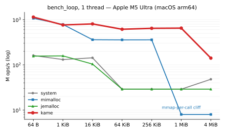
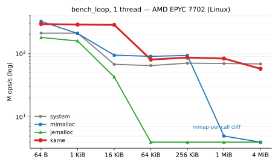
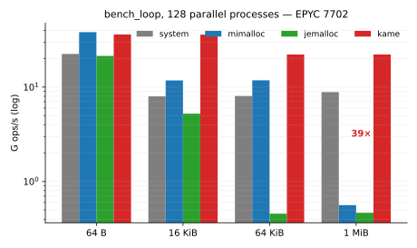
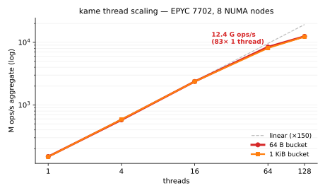

# kamepoolalloc

[](#license)
[]()
[-lightgrey)]()

A lock-free, per-thread, four-tier pool allocator spanning **1 B to multi-GiB** —
bucketed small objects, dedicated mid chunks, `munmap`-backed large blocks, and a
multi-region huge tier for requests above 32 MiB, all freed through one uniform path.  Born for **multi-threaded STM-style
transactional workloads** but usable as a general-purpose drop-in `new` /
`delete` (or C `malloc`) replacement on macOS, Linux, and Windows (MinGW + MSVC).

Carved out of the [KAME](https://github.com/northriv/KAME) measurement framework
and **dual-licensed under Apache 2.0 OR GPL-2.0-or-later** at your choice — so
it can be embedded into permissive / proprietary projects (Apache 2.0 path) or
linked into GPLv2-only projects such as KAME itself (GPL path).
Its sibling library
[**kamestm**](https://github.com/northriv/KAME/tree/master/kamestm) — the
lock-free software transactional memory this allocator was born to serve —
is maintained the same way (dual-licensed, TLA+/GenMC verified) and shares
the `atomic_smart_ptr.h` lock-free smart-pointer header that ships with
this library.

## Highlights

- **Lock-free fast path** — TLS freelist pop/push, no atomics on the hot path.
  Hot-path TLS is `initial-exec` (no `__tls_get_addr` thunk).
- **Four allocation tiers, one `free`** — every pointer is resolved in O(1) by
  a 2-level radix tree, so `free`/`realloc`/`malloc_usable_size` work uniformly
  across all tiers:
  - **Buckets** (1 B .. 32 KiB): 51 size classes.  The ALIGN ≥ 1024 tiers are
    *full-usable* (per-slot metadata in a chunk-header side array, not a borrow
    header), so power-of-2 page requests (4/8/16/32 KiB) get an exact,
    page-aligned slot with **0 % round-up**.
  - **Dedicated chunks** (32 KiB .. 4 MiB): one N-unit chunk from a 32 MiB pool
    region.
  - **Large mmap** (4 MiB .. 32 MiB): one 32-MiB-aligned `mmap` per allocation,
    served warm from the recycle cache, **`munmap`'d on free** when not recycled.
  - **Huge mmap** (> 32 MiB): a multi-region `mmap` per allocation, of which only
    the head 32-MiB radix slot is registered — safe because the allocation's sole
    valid pointer resolves to that slot and the tail slots are never standalone
    lookup targets (and the OS keeps the whole span mapped, so no other allocation
    can claim a tail slot's VA).  **`munmap`'d on free**; bypasses the recycle
    cache (its log index tops out at 32 MiB, so a cached huge block could
    over-satisfy a smaller huge request and pin its RSS — the reason
    libc / jemalloc / mimalloc don't pool their huge class).  Plain libc `malloc`
    is reached only if the `mmap` itself fails.
- **Two-level recycle cache** for the dedicated-chunk and large-`mmap` tiers
  (32 KiB .. 32 MiB; the > 32 MiB huge tier bypasses it): a
  per-thread **L1** (no atomics, ping-pong absorbed) in front of a global
  lock-free **L2** log-slot cache (no working-set cliff, byte-capped).  Reuses
  warm, resident blocks — skips the `mmap`/`madvise`/re-fault cost that makes
  every other allocator fall off a cliff above ~64 KiB.
- **Aligned allocation served from the pool** — `posix_memalign` /
  `aligned_alloc` / `operator new(align_val_t)` up to 4 KiB alignment route to
  the matching bucket (slots are inherently ALIGN-aligned); larger alignments
  use the 256 KiB-aligned dedicated/mmap tiers.  No `_aligned_free` pairing —
  freed by the ordinary `free`.
- **Per-thread DLL chunks** — no global allocator lock, no contention until
  the chunk-claim slow path; cross-thread frees via a holding batch +
  bit-clear coalescing.
- **Lock-free orphan-chunk reclaim (`atomic_shared_ptr`)** — a chunk left
  non-empty by an exited owner thread (its slots still draining via cross-thread
  frees) is pushed onto a per-template lock-free orphan **chain** instead of
  being stranded: another thread later *adopts* it (reuses its free slots) and a
  sweep pass *reclaims* it once drained, so churned worker threads don't grow
  reserved memory.  The chain is built on KAME's `atomic_smart_ptr` (the same
  lock-free reference-counted smart pointer as the STM) — that refcount is what
  makes adopt-vs-reclaim safe without hazard pointers, and a re-owned chunk holds
  a self-referential owner-ref so a concurrent sweeper can't free it mid-reuse.
  Replaces an earlier ABA-tagged Treiber stack that leaked drained orphans.
- **Standards-conformant OOM** — throwing `operator new` runs the installed
  `std::new_handler` loop then throws `std::bad_alloc`; nothrow / C-API paths
  return `nullptr` + `errno = ENOMEM`.  No `std::terminate` across the noexcept
  C boundary.
- **Bounded VA + prompt RSS** — two independent runtime caps:
  `kame_pool_set_max_bytes()` (fresh-region mmap ceiling) and
  `kame_pool_set_large_cache_cap()` (the large-recycle cache's resident
  footprint, split ~half global L2 / ~half aggregate per-thread L1).
  `madvise(MADV_FREE/DONTNEED)` on chunk release — default also at thread exit,
  toggle via `kame_pool_set_thread_exit_reclaim()`.
- **Coexists with a foreign allocator on every OS** — the pool intercepts
  `free`/`delete` the native way per platform so a pointer it allocated is
  pool-freed no matter which module frees it: ELF strong symbols (Linux),
  Mach-O `__DATA,__interpose` (macOS), and a runtime free-family IAT redirect
  on Windows (§31) — the PE/COFF analogue, scoped to the deallocation family,
  so KAME allocations use the pool while Qt / CRT allocations stay on the CRT
  heap and frees are reconciled wherever they happen.
- **Drop-in `malloc` replacement (macOS dylib, default-on)** — when built as a
  standalone dynamic library (`-DKAMEPOOLALLOC_DYLIB`) on macOS, the pool also
  interposes the full `malloc` family by default, so it works as a real
  `DYLD_INSERT_LIBRARIES=libkamepoolalloc.dylib` drop-in like mimalloc / jemalloc
  — every `malloc` / `calloc` / `realloc` / `posix_memalign` / `aligned_alloc` /
  `free` in the host process routes through the pool.  (Through v1.2.0 `calloc`,
  `posix_memalign` and `aligned_alloc` were left to libsystem.)
  A `malloc_size` co-interpose returns the true capacity of pool pointers, which
  is what makes this Swift- and Objective-C-safe (the Swift runtime's
  `__StringStorage` and ObjC class realization query `malloc_size`; an allocator
  that lies here corrupts them).  Soak-validated against Foundation, libswiftCore,
  CPython, QtCore, and the C++ STL.  Opt out with
  `-DKAMEPOOLALLOC_CONSERVATIVE_INTERCEPT` for the `free`/`realloc`-only behaviour.
  Linux/Windows dylibs keep this behind the explicit `-DKAMEPOOLALLOC_FULL_INTERCEPT`
  opt-in pending their own soak.  The inline kame.app build (an `MH_EXECUTE`
  image) is unaffected either way — dyld honours `__interpose` only from
  `MH_DYLIB`, so only the strong-symbol `operator new`/`delete` override is live
  there, as before.
- **Verified** — TSAN race-free, UBSAN clean (incl. `vptr`), ASan clean; the
  chunk-claim / chunk-recycle protocol is TLA+ model-checked and the
  large-recycle cache's exclusive-ownership / no-premature-release (UAF /
  double-free) safety is GenMC (RC11) model-checked.  The orphan-chunk
  reclaim/adopt chain is TLA+ model-checked too
  ([`tests/tlaplus/OrphanChain_*.tla`](tests/tlaplus/), run by
  `run_orphan_chain.sh`) — its owner-free-vs-concurrent-sweeper-pin race is a
  model-only catch (runtime stress can't reproduce it), kept as a standing
  regression guard.  Builds 64-bit and 32-bit,
  on macOS / Linux / Windows (MinGW + MSVC).
- **Realtime mode with a written contract** — per-thread gating so a marked
  thread's `free()` never enters the kernel, `kame_pool_prewarm()` (which
  page-touches, unlike the allocate+free idiom), an explicit
  `kame_pool_rt_drain()`, and runtime-checkable violation counters.  Measured
  192 ns vs 16.4 µs median free (and 709 ns vs 54.2 µs max) on the band where
  the recycle cache cannot help, draining once per cycle (M5 Ultra); and on a
  `PREEMPT_RT` host with isolated cores — quiet enough for the figure to mean
  something — **352 ns vs 42.4 µs worst case** on cross-thread small free,
  bought with 1.8× on the median.
  Preconditions and exclusions are stated in
  [The realtime contract](#the-realtime-contract) — not implied.

## Status

**Production-stable in KAME** since 2008 (the lock-free pool joined the
KAME measurement framework — itself in 24/7 research-lab operation since
2002 — as the system allocator that year, and has been the production
allocator on every release since).  The Phase 5 / §15–§30 work (2025 – 2026) added the
buddy chunk allocator, the full-usable page-aligned bucket tiers, the
dedicated / large-`mmap` / huge (> 32 MiB) tiers with a two-level recycle cache,
pool-routed aligned allocation, and standards-conformant OOM.

**Targets:** macOS and Windows (64-bit) for KAME itself; the standalone library
also builds and is tested on Linux (64-bit and 32-bit) under both **glibc and
musl** — continuously build-and-run-checked on **Ubuntu, Fedora, and
Alpine/musl** (the mimalloc-bench CI matrix).  Requires a host with `mmap`
(or `VirtualAlloc`) and threads — not an MCU / bare-metal allocator.

**Per-toolchain status of the live pool:**

| Toolchain | Live pool | Notes |
|---|---|---|
| macOS clang (x86-64 / arm64) | ✅ default | `__DATA,__interpose` `free` redirect; dylib build also interposes `malloc` / `calloc` / `posix_memalign` / `aligned_alloc` + `malloc_size` by default (Swift/ObjC-safe drop-in), opt out with `-DKAMEPOOLALLOC_CONSERVATIVE_INTERCEPT`; primary target |
| Linux gcc/clang (x86-64, 32-bit), **glibc & musl** | ✅ default | strong-symbol redirect of the full family — `free` / `malloc` / `calloc` / `realloc` / `reallocarray` and the aligned set (`memalign` / `posix_memalign` / `aligned_alloc`); on musl the aligned/teardown paths get explicit handling (musl implements `memalign` on the public `malloc`, and frees TLS during `__pthread_tsd_run_dtors`).  mimalloc-bench CI runs the full suite (incl. rptest / rocksdb) crash-free (`signal 11` = 0) on **Ubuntu, Fedora, and Alpine/musl**; primary CI target |
| Windows **MinGW64 + lld** | ✅ default | §31 free-family IAT redirect lets the pool coexist with Qt / libc++ (PE/COFF has no cross-module `operator new` interposition); verified on-target with Qt 6.10.1 |
| Windows **MSVC** (cl) | ✅ default | runs the full live pool — the `_MSC_VER` shim in `allocator_prv.h` bridges the GCC-isms (`_Interlocked*` atomics, `<intrin.h>` bit-scan / overflow, static-init constructor hook) and the §31 redirect handles Qt/CRT coexistence; opt OUT with `KAME_DISABLE_POOL_MSVC` |

## Benchmarks

Tight alloc/free loop, one slot at a time (`tests/bench/bench_loop.c` —
`malloc(N)` → write `p[0]` → `free(p)` repeated), median of repeated runs.
`kame` is `LD_PRELOAD`'d against the same binary as the others; all are
default-Release builds (no `-flto` / `-march=native` — mimalloc and jemalloc
ship the same way).  Multi-thread numbers run 4 independent `bench_loop`
processes in parallel and sum the per-process rates (true intra-process MT
is measured separately by `bench_xthread`).  All tables below are
reproducible via `tests/bench/bench_compare.sh` (see that script's
`--help`).  The x86-64 reference machine is **Ohtaka** (ISSP supercomputer,
AMD EPYC bare metal — single-tenant, `srun --exclusive`); cloud VM numbers
were intentionally dropped because shared-tenant scheduling jitter on a
single allocator could swing 3× between sessions and made any absolute
comparison unreliable.

<p align="center">
 
 
</p>

The four charts above are plotted from the tables that follow
(regenerate with `tests/bench/plots/make_plots.py`).  The story is the
**flat red curve**: no mmap-per-call cliff at the ≥ 1 MiB tier, and
near-linear scaling to 128 cores.

**Apple Mac Studio M5 Ultra (arm64, macOS), single thread, M ops/s** —
kamepoolalloc at `2e8f940fd`, median of 7 runs via `bench_compare.sh`
(mimalloc 3.3.2 and jemalloc 5.3.0, built from their release sources).  Both
tables below come from one run, on a machine that was not idle (a remote-
desktop host used about two cores); the record, with provenance, is
`design/README_BENCH_M5.md`:

| size      |  system | mimalloc | jemalloc |     kame |
|-----------|---------|----------|----------|----------|
| 64B       |     162 |     1055 |      168 | **1135** |
| 1 KiB     |     135 |      766 |      164 |  **804** |
| 16 KiB    |     142 |      356 |      105 |  **891** |
| 64 KiB    |      28 |  **354** |       29 |      192 |
| 256 KiB   |      28 |  **360** |       29 |      180 |
| 1 MiB     |      28 |        8 |       29 |  **167** |
| 4 MiB     |      46 |        8 |       28 |  **149** |

**Apple Mac Studio M5 Ultra, 4 processes aggregate, M ops/s** — median of 7
runs:

| size      |  system | mimalloc | jemalloc |     kame |
|-----------|---------|----------|----------|----------|
| 64B       |     641 |     3981 |      619 | **4258** |
| 16 KiB    |     525 |     1341 |      386 | **3340** |
| 64 KiB    |     106 | **1337** |      109 |      721 |
| 1 MiB     |     105 |       23 |      109 |  **645** |

kame leads every band except 64–256 KiB.  At **64 B** it is ahead of
mimalloc 3.3 — 1135 vs 1055 M ops/s single-thread, 4258 vs 3981 across 4
processes — through the `deallocate` / `operator new` hot/cold splits (lean
`always_inline` FS=true fast path, no prologue spill), the `KameTlsPage`
fast-TSD unification (§hot-tls, a single `mrs TPIDRRO_EL0` instead of
per-variable `_tlv_get_addr`), and the §word-cache cold path of the time
(its claim now feeds the thread lists below); **1 KiB**
is 804 vs 766.  At **16 KiB** kame leads decisively — 891 vs 356
single-thread, 3340 vs 1341 across 4 processes — helped by the void /
tail-call FS=false free path.  At the **1 MiB** large tier kame leads at
every thread count: system is lock-serialised, mimalloc collapses to ~8 M
single-thread / ~23 M aggregate, while kame stays memory-warm at 167 / 645 M
ops/s.  The one band where mimalloc leads is the **64–256 KiB** §19 large
tier (kame ~185 vs ~355 single-thread, 721 vs 1337 across 4 processes):
there the per-free radix lookup plus recycle-cache bookkeeping cost more
than mimalloc's segment scheme — a known weaker tier.

### §thread-list — per-thread free lists; no walk over chunks

A thread's own frees go onto its list for the slot's bucket
(`KameTlsPage::m_slots[b]`), whichever chunk holds the slot, and its
mallocs pop that list — a load, a dependent load and a store, and a push
on the free.  A miss therefore means the thread holds no free slot of the
bucket anywhere: there is nothing to look for in its other chunks, and the
allocation path never walks them.  (Through v1.2.1 each chunk kept its own
freelists behind a per-bucket shortcut into one of them, and a miss went
looking for a chunk with entries — a scan of up to 64 chunks, or in v1.2.0
a list of them kept exact at a cost on every free.)

The other two places a slot comes from are bounded the same way.  The
bitmap room a variable-size chunk keeps when it cannot serve a request goes
on per-thread **fit lists**, filed by the largest of the tier's sizes it
still fits; a request tries at most four of them.  The slots that
cross-thread frees return to a fixed-size chunk's bitmap are claimed a
whole word per CAS and handed to the thread's list in one store — the claim
of the earlier §word-cache, without its cold-path mask.  A thread keeps
about 4 MiB of its freed memory per bucket: when a list reaches 256 KiB it
is sealed as a segment and starts again with the newest slot, and past 15
sealed segments the oldest goes back to its chunks in one go, where a chunk
it empties is released (`KAME_TL_SEG_BYTES`, `KAME_TL_SEGS`; a realtime
thread returns single slots instead).  So a thread that frees one size and
goes on to another does not keep the first — 400 MiB of 64 B freed, then
400 MiB of 1 KiB, peaked at 1053 MiB before and 631 MiB now (581 after
`kame_pool_trim()` empties the recycle cache; mimalloc 480) — at the price of
the free that returns a segment: freeing 200 MiB of 64 B or 1 KiB blocks on
the M3, the slowest free took 31–56 µs (without the cap, 4–39 µs).  The cap
bounds the bytes kept, not the chunks they hold: freed in a random order,
the last megabytes of frees lie on every chunk.  So before a thread takes a
new chunk, any bucket whose list has not moved since the last time gives
back everything it keeps, and `kame_pool_trim()` gives back all of the
calling thread's.

MacBook Air M3 against v1.2.1, interleaved (`bench_ab.sh`, median of 3;
`tests/bench/micro`, median of 5): single-thread random-replacement churn
1.05–3.3×, and 100 vs 1284 ns per allocation where allocations run ahead of
the frees (`heavy`: v1.2.1's scan went round 64 chunks for nothing); SPSC
ring of 64 B blocks with 32 in flight 50 vs 28 M ops/s; `xmalloc-test` 64 B
(4 pairs) 1.13×, level with mimalloc; `larson` 1.19×; `bench_xthread`
1.14×; the game-frame bench's median frame 0.61× (frame rate 1.5×), still
1.3× mimalloc's; `bench_loop` and STM `3level_mixed` level.  The record is
`design/GAME_FRAME_BENCH.md`, the bounds `design/RT_READINESS.md`.  The
tables above predate it (v1.2.1).

### Third-party suite cross-check (mimalloc-bench, M5 Ultra)

An independent run of the contention-heavy multi-thread benches from
[mimalloc-bench](https://github.com/daanx/mimalloc-bench) on the M5 Ultra:
10 threads (its performance cores), median of 5 via
`tests/bench/bench_ab.sh`, mimalloc 3.3.2 / jemalloc 5.3.0, kame at
`2e8f940fd` (`design/README_BENCH_M5.md` §2); rptest re-measured once the
dylib also interposed `calloc` / `posix_memalign` (§2.1).

The suite carries kamepoolalloc upstream as **`kp`**, so nothing here has to
be taken on trust — the same comparison is two commands on any Linux host:

```sh
./build-bench-env.sh kp mi je      # clones kamepoolalloc at its pinned tag
./bench.sh sys mi je kp allt
```

| bench (M ops/s, ↑) | system | mimalloc | jemalloc |  kame |
|--------------------|--------|----------|----------|-------|
| xmalloc-test       |    249 |  **501** |      400 |   489 |
| larson             |   26.1 |      222 |  **425** |   267 |
| rptest             |   2.64 |     5.77 |     6.20 | **6.29** |

On `xmalloc-test` — one thread allocates, another frees, the STM Snapshot
handoff that is kame's design target — kame is level with mimalloc and ahead
of jemalloc and system.  On `larson` it is ahead of mimalloc and ten times
system malloc, but jemalloc leads on this machine.  On `rptest`'s mixed
cross-thread churn kame is level with jemalloc and mimalloc, at 2.4x system
malloc.  (rptest allocates only through `calloc` and `posix_memalign`; until
the dylib interposed those, this row measured system malloc plus kame's
`free` forwarding — 2.40.)

**Intel Xeon E5-1630 v4 (x86-64, 4-core / 8-thread, Windows), single thread,
M ops/s** — kame at `8f2e6980` (post hot/cold-split + 32 KiB bucket LUT +
word-cache), llvm-mingw clang 17, median of 5 via `bench_compare.sh`.  On
Windows the `kame` column is the **direct pool route** (`bench_loop_pool` →
`kame_pool_malloc`): PE/COFF has no `LD_PRELOAD`, and llvm-mingw resolves the
plain `malloc` statically (no IAT entry for the §31 redirect to patch), so —
unlike the macOS/Linux tables — this measures the pool core only, not the
malloc-override layer.  mimalloc/jemalloc are not standard on Windows
(columns omitted):

| size      |  system |     kame |
|-----------|---------|----------|
| 64B       |      37 |  **301** |
| 1 KiB     |      40 |  **223** |
| 16 KiB    |      39 |  **191** |
| 64 KiB    |       9 |   **71** |
| 256 KiB   |      10 |   **68** |
| 1 MiB     |      ~0 |   **64** |
| 4 MiB     |      ~0 |   **35** |

**Same host, 4 processes aggregate, M ops/s** — median of 5:

| size      |  system |     kame |
|-----------|---------|----------|
| 64B       |     144 | **1055** |
| 16 KiB    |     134 |  **687** |
| 64 KiB    |      37 |  **238** |
| 1 MiB     |      ~1 |  **231** |

The **system ~0 at ≥ 1 MiB** is the Windows UCRT per-call `VirtualAlloc` /
`VirtualFree` cliff (the same shape mimalloc / jemalloc hit at this tier on
Linux): a tight 1 MiB `malloc`/`free` loop drops below 0.5 M ops/s, while
kame's two-level recycle cache stays memory-warm at 35–231 M ops/s.  The
16 KiB jump (90 → 191 single-thread, 302 → 687 4-process vs the prior
`84f97566` numbers) is the full-range bucket LUT + word-cache landing; no
size regressed.

**Ohtaka (ISSP supercomputer — AMD EPYC 7702, 128-core / 8-NUMA-node, Linux
4 KiB pages, `THP=always`), `bench_compare.sh`, `--exclusive` jobs** —
kamepoolalloc at `19b2e4758` (the v1.2.1 allocator), clang 18.1.8,
re-measured 2026-10-12 (`design/README_BENCH_OHTAKA.md`).  The 1T and
128-process tables ran on `i8cpu` node `c15u01n1`, where the June tables
were measured; the 4-process table on `c15u02n1`, which measures every
allocator 1–7 % lower.  Against June the comparators reproduce to ±2 % and
kame to within a few percent.  mimalloc (3.3.2) and jemalloc (5.3.1) are the
competitive tables' builds:

**Architecture note — memory renaming**: kamepoolalloc's LIFO freelist
creates a tight store-then-load chain on every alloc/free pair
(`free`: `*p = head; head = p` → next `malloc`: `head = *head`).  On
CPUs with **memory renaming** — Intel Sunny Cove (Ice Lake, 2019) and
AMD Zen 3 (Milan, 2020) onward, plus Apple A12+ / M-series — the
rename stage forwards the just-stored value to the load via the
register file, dispatch-free.  AMD Zen 2 (Ohtaka's EPYC 7702)
**predates this optimization** and pays store-to-load forwarding
latency (~5 cycles) per hot iteration instead.  This is the
structural reason the Ohtaka margins over `mimalloc` / `jemalloc` are
smaller than the Apple figures — most visible at the **64 B tier** where
the freelist hot path dominates (Ohtaka kame 259 vs mi 327; M5 Ultra kame
1135 vs mi 1055).  Larger tiers
where the freelist is not the bottleneck (16 KiB, 1 MiB+) are not
affected and kame retains its lead on both CPUs.  The 64 B gap is
expected to narrow on Zen 3 / Zen 4 (Milan, Genoa, Bergamo) and on
Sapphire Rapids / Granite Rapids Intel parts; Cascade Lake-SP cloud
VMs (e.g. AWS C5 / GCP N2) inherit the same Skylake-derived non-
renaming microarchitecture and behave like Zen 2 in this respect.

## 1T (median of 5, M ops/s)

| size      |  system | mimalloc | jemalloc |     kame |
|-----------|---------|----------|----------|----------|
| 64B       |     212 |  **327** |      182 |      259 |
| 1.0KB     |     210 |      217 |      160 |  **228** |
| 16KB      |      69 |       95 |       45 |  **173** |
| 64KB      |      65 |   **95** |        4 |       79 |
| 256KB     |      71 |   **95** |        4 |       80 |
| 1.0MB     |      71 |        5 |        4 |   **83** |
| 4.0MB     |  **70** |        4 |        4 |       59 |

## 4 parallel processes (aggregate, M ops/s, median of 5)

| size      |  system | mimalloc | jemalloc |     kame |
|-----------|---------|----------|----------|----------|
| 64B       |     825 | **1245** |      711 |     1014 |
| 16KB      |     268 |      371 |      172 |  **681** |
| 64KB      |     253 |  **370** |       16 |      308 |
| 1.0MB     |     277 |       20 |       16 |  **326** |

## 128 parallel processes (aggregate, M ops/s, median of 5)

| size      |  system | mimalloc | jemalloc |     kame |
|-----------|---------|----------|----------|----------|
| 64B       |   22575 | **39396** |    21184 |    31006 |
| 16KB      |    7995 |    11772 |     5263 | **22001** |
| 64KB      |    8101 | **11864** |      469 |     9903 |
| 1.0MB     |    8917 |      562 |      473 | **10567** |

At **16 KiB** kame leads decisively at every thread count — 173 vs 95 M
single-thread, 681 vs 371 at 4 processes, 22001 vs 11772 at 128 (1.9×) —
from the `bucket_for_size` LUT extension to the full 32 KiB bucketed range
(`9b65ce42`) plus the force-inlined size→bucket fold (`0e43ee82`).  At
**1 MiB / 128 processes** kame reaches **10567 M ops/s** (19× ahead of
mimalloc 562 M): the two-level recycle cache keeps all 128 cores at
memory-warm speed while mimalloc stalls at its per-call `mmap` path.  At
**1 KiB** single-thread kame leads mimalloc narrowly (228 vs 217 M).
mimalloc leads at **64 B** on x86-64 — 327 vs 259 M single-thread, 39396 vs
31006 at 128 processes: unlike arm64 (the M5 Ultra above), where the
`deallocate` / `operator new` hot/cold splits put kame ahead at 64 B, on
x86-64 mimalloc's thread-local bump allocator keeps the edge on the smallest
bucket.  mimalloc also leads at **64–256 KiB**, where kame's dedicated-chunk
tier runs at 79–80 M against its 95, and glibc at **4 MiB** single-thread
(70 vs 59 M; see the `M_MMAP_THRESHOLD` note below).

---

**Ohtaka, `--exclusive` job, single-binary self-validation via
`tests/alloc_tune_report`** — kamepoolalloc at `19b2e4758`, node `c15u04n4`:

Aggregate M ops/s (`alloc → touch byte 0 → free` loop) at 1 / 4 / 16 / 64 /
128 concurrent threads:

| size,tier                  |  1T  |  4T  |  16T |  64T | 128T |
| -------------------------- | ---: | ---: | ---: | ---: | ---: |
| 64 B  (bucket)             |  132 |  507 | 2097 | 7656 | **12381** |
| 1 KiB (bucket)             |  114 |  457 | 1824 | 6641 | **11253** |
| 64 KiB (chunk)             |   43 |   31 |   69 |  171 |   **353** |
| 1 MiB (chunk)              |   42 |   37 |  127 |  135 |   **351** |
| 8 MiB (large_va)           |   29 |  7.4 |  4.4 |  3.6 |     2.8 |
| 40 MiB (large_va, cached)  |   12 |  2.6 |  3.7 |  2.2 |     2.5 |

Each cell is one run, as in June.  The bucket rows repeat to within 10 %;
the chunk rows from 16 threads do not — three repeats on another node gave
64 KiB / 128T 186–283 and 1 MiB / 128T 345–431, so read those cells as
ranges (June's single run had 1 MiB / 128T at 543).

The bucket tier reaches **12.4 G ops/s aggregate for 64 B at 128 cores
(94× linear)** — vindicating the per-thread DLL + per-thread freelist +
per-thread `KameTlsPage` design on a heavily-NUMA host.  The 1 MiB chunk
tier reaches **345–431 M ops/s at 128T** over four runs — the per-thread L1
recycle cache absorbs the churn, with more run-to-run spread than the bucket
tier.  The large_va tier (8 MiB+) plateaus because the benchmark touches
byte 0 each cycle, which serialises across cores in the Linux process-wide
`mmap_lock` page-fault path; real KAME workloads write the whole buffer right
after alloc (`memcpy` of acquisition data, FFT in-place) so the one-page
fault is amortised inside the buffer write, not paid per op.

The same `alloc_tune_report` run self-validated the defaults on this hardware:

- **`LRC_LAZY_INTERVAL_NS = 10 ms`**: 0.63 % per-thread wallclock pressure —
  printed "default 10 ms is fine; auto-tune kept it (raise-only)".
- **`LRC_K_MAX = 256`**: matched to 128 cores — printed "default is
  appropriate".
- **`MADV_HUGEPAGE`**: ineffective on this kernel (same `µs/page` as plain
  first-touch) because `THP=always` is already auto-promoting 4 KiB pages to
  2 MiB at the kernel level.
- **TLB shootdown**: a 32 MiB `munmap` costs 1.4–1.7 ms at 128 threads over
  four runs (19.95× the 1-thread cost in this run; the 1-thread baseline
  itself moves, so the ratio ranged 8.7–21.6×) — bounded, not catastrophic;
  the warm cache absorbs most syscalls in practice.

The size sweep's headline is the **cliff**: jemalloc drops to 4 M ops/s from
64 KiB and mimalloc from 1 MiB (95 → 5) — both revert to per-call
`mmap`/`munmap` — while kame's recycle cache holds 79–83 M ops/s through
1 MiB, 17–21× mimalloc and jemalloc there.  The system allocator (glibc
ptmalloc) is also flat at large sizes in this particular tight-loop pattern
because ptmalloc adaptively raises its `M_MMAP_THRESHOLD` when it observes
repeated large alloc/free pairs; in production workloads with mixed sizes,
that threshold is not permanently raised and large allocs revert to per-call
`mmap`, closing the same cliff.

The multi-thread picture is the same shape: at 4 processes jemalloc collapses
at 64 KiB (16 M ops/s) and mimalloc at 1 MiB (20 M ops/s), while kame scales
about 4× from single-thread at every size.  These are **touch-first-byte**
benchmarks — `malloc(N)`, write `p[0]`, `free(p)` — so only one page fault is
issued per op regardless of `N`.  Workloads that *write the whole buffer*
converge on memory bandwidth and the per-op allocator cost is amortised.

The point is not the micro-benchmark peak but the **flat curve**: kame has no
size cliff and no per-thread working-set cliff, so a real mixed workload (small
objects + large arrays/waveforms — KAME's own profile) never hits the
`mmap`-per-large-alloc wall the others do.

**Ohtaka — competitive comparison, mimalloc-bench suite** (`sys` = glibc
2.28, `mi3` = mimalloc 3.3.2, `mi` = mimalloc 1.8.2, `je` = jemalloc 5.3.1,
`tc` = gperftools 2.18 `tcmalloc_minimal` — the builds of mimalloc-bench at
`941c265d`).  Same EPYC nodes as above (kernel `4.18.0-372.9.1.el8.x86_64`,
clang 18.1.8); kamepoolalloc at `19b2e4758` (v1.2.1), re-measured 2026-10-12
with `tests/bench/bench_ab.sh` — one binary per workload, the allocator
switched by `LD_PRELOAD`, the six arms interleaved, median of 5
(`design/README_BENCH_OHTAKA.md` §3 has the ranges).  Bench invocations:
`xmalloc-test -w N -t 5 -s S`; `larson 5 8 1000 5000 100 4141 N`;
`mstress N 50 50`; `rptest N 0 1 2 500 1000 100 8 16000` (random size
8..16000 B, cross-thread free rate 2, 500 loops, 1000 allocs, 100 ops per
iter).  The best value in each row is bold.

**xmalloc-test — cross-thread handoff, M frees/s (higher=better).**  N
threads allocate and N others free — the STM Snapshot handoff pattern, where
a measurement thread allocates a Payload and the UI thread releases it.

64 B objects (`-s 64`, as mimalloc-bench runs it):

| workers |  sys |  mi3 |       mi |      je |    tc | **kame** |
| ------: | ---: | ---: | -------: | ------: | ----: | -------: |
|       1 | 5.63 | 33.9 | **34.7** |    26.8 |  8.88 |     31.9 |
|       4 | 16.5 |  109 |     96.0 |    92.7 |  1.65 |  **127** |
|      16 | 67.9 |  335 |      248 |     394 |   1.1 |  **494** |
|      64 |  189 |  431 |      365 |     867 | 0.783 | **1149** |
|     128 |  186 |  415 |      391 | **922** | 0.843 |      422 |

1024 B objects (`-s 1024`, xmalloc-test's default):

| workers |  sys |      mi3 |       mi |   je |    tc | **kame** |
| ------: | ---: | -------: | -------: | ---: | ----: | -------: |
|       1 | 3.31 | **24.0** |     22.9 |    5 |  3.14 |     6.17 |
|       4 | 9.46 |     54.0 | **63.5** | 15.5 |  1.13 |     18.3 |
|      16 | 17.3 |      129 |  **188** | 55.8 | 0.796 |     71.7 |
|      64 | 13.5 |      199 |  **258** |  173 | 0.623 |     51.1 |
|     128 |  8.4 |  **199** |      177 |  160 | 0.604 |     76.2 |

At 64 B kame leads from 4 to 64 worker pairs (1.2–1.3× the next best) and is
level at 1; at 128 pairs it drops to 422, level with mi3 / mi and behind
jemalloc (922) — that step, and kame's wide spread at 64 pairs (709–1283
over the five runs), are open items.  At 1024 B mimalloc leads at every
count (2.6–5.0× kame), and jemalloc passes kame from 64 pairs; kame beats
glibc throughout (1.9–9×).  (Until v1.2.1 this README
showed that 1024 B run under a 64 B title; kame has since become 1.6–2.1×
faster on it, except at 64 pairs.)

**larson — server simulation: worker threads exit and are replaced, their
live blocks freed by their successors, M ops/s (higher=better):**

| threads |  sys |  mi3 |       mi |   je |       tc | **kame** |
| ------: | ---: | ---: | -------: | ---: | -------: | -------: |
|       1 | 21.8 | 32.4 |     42.0 | 36.1 | **45.1** |     22.9 |
|       4 | 50.4 | 63.7 |  **105** | 93.1 |     94.7 |     62.8 |
|      16 |  170 |  228 |  **370** |  349 |      336 |      224 |
|      64 |  589 |  878 | **1335** | 1260 |     1101 |      650 |

kame is ahead of glibc only (1.05–1.32×), level with mi3 at 4–16 threads,
and behind mimalloc, jemalloc and tcmalloc by 1.5–2.1×.  On the M5 Ultra
kame is ahead of mimalloc on larson (above); the gap here is not profiled
yet.  No 128-thread row: larson has `MAX_THREADS 100` and crashes beyond it
under every allocator.

**mstress — random object migration across threads, wall time s
(lower=better):**

Allocations are passed between threads at random — analogous to STM
Transactions that write a new Payload on one core and the old one is released
on another.

| threads |    sys |       mi3 |        mi |     je |     tc | **kame** |
| ------: | -----: | --------: | --------: | -----: | -----: | -------: |
|       1 | 0.0691 | **0.054** |    0.0544 | 0.0596 | 0.0569 |   0.0573 |
|       4 |  0.639 |     0.448 | **0.444** |  0.929 |  0.656 |    0.603 |
|      16 |   2.64 |  **1.84** |      1.91 |   2.78 |   2.34 |     2.42 |
|      64 |   7.98 |      4.03 |  **3.88** |      8 |   6.32 |      6.3 |
|     128 |   14.4 |      5.95 |  **5.87** |   14.7 |   10.2 |     9.61 |

kame beats glibc and jemalloc at every thread count, is within 4 % of or
ahead of tcmalloc, and trails mi / mi3 by 1.3–1.6× from 4 threads up.

**rptest — realistic mixed workload, 8..16000 B random sizes, cross-thread
free, long-lived threads, M ops/CPU-s (higher=better):**

Generally regarded as the most production-representative scenario in the
mimalloc-bench suite — long-lived worker threads (not the worker-respawn
pattern of larson), random size distribution spanning small to medium
objects, and a fraction of frees crossing thread boundaries.

| threads |   sys |  mi3 |       mi |    je |       tc | **kame** |
| ------: | ----: | ---: | -------: | ----: | -------: | -------: |
|       1 |  10.9 | 15.6 |     15.6 |  16.0 | **17.9** |     14.6 |
|       4 |  2.75 | 7.88 | **9.69** |  5.84 |     6.92 |     6.93 |
|      16 |  2.13 |  4.7 | **5.98** |   2.5 |     2.27 |     3.09 |
|      64 |  0.56 | 1.89 | **2.51** | 0.792 |    0.222 |     1.08 |
|     128 | 0.291 | 1.39 | **1.79** | 0.509 |    0.056 |     0.56 |

kame beats glibc at every count (1.3–2.5×) and jemalloc from 4 threads
(1.1–1.4×); tcmalloc leads at 1 thread, is level at 4 and trails kame from
16.  mimalloc leads throughout, by more as threads grow: 1.07× kame at 1
thread, 1.4× at 4, 1.9× at 16, 2.3× at 64, 3.2× at 128.  kame also holds the
most memory — peak RSS (rptest's own report, MiB, range of 5 runs):

| threads |      kame |     sys |       mi3 |        mi |        je |      tc |
| ------: | --------: | ------: | --------: | --------: | --------: | ------: |
|      16 |   209–240 |   51–53 |    98–137 |   134–167 |   171–189 |   69–90 |
|      64 |  941–1094 | 222–245 |   482–675 |   666–721 |   678–778 | 200–226 |
|     128 | 1980–2234 | 483–544 | 1226–1376 | 1190–1460 | 1307–1430 | 353–372 |

— about 1.5× mimalloc / jemalloc and 4× glibc at 64–128 threads, the price
of the per-thread caches on a workload whose blocks cross threads.

On this 128-core x86 host, then, kame beats glibc on every workload at every
thread count, beats jemalloc on mstress and (from 4 threads) rptest, and
leads the field on 64 B handoff from 4 to 64 pairs; mimalloc leads where
cross-thread traffic grows with the thread count — 1024 B handoff, larson,
rptest from 16 threads — and kame pays for its per-thread caches in memory.

## Build

### qmake (KAME-integrated)

```bash
cd kamepoolalloc
qmake kamepoolalloc.pro
make
# produces libkamepoolalloc.dylib (macOS) / libkamepoolalloc.so (Linux)
```

### Standalone (cmake test scaffold)

```bash
cd tests
mkdir build && cd build
cmake .. -DCMAKE_BUILD_TYPE=Release
make
ctest --output-on-failure
```

`ctest` runs the C-API conformance test.  The repo also ships manual
correctness / perf drivers built alongside it: `alloc_stress_test`
(adversarial multi-thread, sentinel-checked), `alloc_minimal_bench`
(single-size hot / fifo loops), and `alloc_bucket34_repro`.  Sanitizer
coverage (TSAN / UBSAN / ASan) is obtained by configuring the build with
the matching `-fsanitize=` flags.  Two things to know on macOS:

- **UBSan's `vptr` check is not in Apple clang.**  Its `-fsanitize=undefined`
  leaves `vptr` out, so a member access through a `PoolAllocatorBase *` where
  no such object lives never shows up there.  Build with LLVM's clang (or GCC
  on Linux), whose `-fsanitize=undefined` includes it.  Over the whole
  `tests/` tree, LLVM 19 reports nothing (2026-10).
- **ThreadSanitizer and the pool both interpose `malloc`.**  TSan takes it,
  so the pool's interposition is not in effect.  A block the pool handed out
  can then reach TSan's `free` (a thread's TSD destructor at exit), and TSan
  stops on a `sanitizer_allocator_secondary.h` CHECK.  Under TSan on macOS
  this ends 9 of the pool's 18 ctest entries early: `alloc_huge_test`,
  `alloc_tsd_exclusivity_test`, `alloc_evict_test`,
  `alloc_realtime_mode_test`, `alloc_rt_thread_test`, `bench_rt_wcet_smoke`,
  the two `alloc_thread_exit_*_test_dynamic`, and `malloc_intercept_test`,
  which finds malloc not interposed and then crashes.  This is a tool limit,
  not a pool fault.  The other nine run, as do `bench_xthread_pool` and the
  kamestm tests over the pool.  None of them reports a data race in the pool
  or the STM (macOS arm64, 2026-10); the one report left is in
  `atomic_queue_test`'s own code.

### Windows

- **MinGW64 + lld** (the validated Windows toolchain): builds with the live
  pool on by default.  The qmake test path inline-compiles `allocator.cpp`
  into each test binary (PE/COFF won't let a test bind to the DLL's
  `operator new`), so the test actually exercises the pool; the §31
  free-family redirect installs from the auto-activator to reconcile the
  cross-module frees.
- **MSVC** (cl): runs the full live pool by default — the `_MSC_VER` shim
  in `allocator_prv.h` provides the `_Interlocked*` atomics, the `<intrin.h>`
  bit-scan / `_mul_overflow` mappings, and `NOMINMAX`.  Opt OUT with
  `KAME_DISABLE_POOL_MSVC` to force the `std::allocator` fallback (e.g. when
  bisecting an allocator-suspected issue).
- Env knobs (Windows live pool): `KAME_POOL_WIN_REDIRECT=0` disables the §31
  free redirect (restores the historical unreconciled behaviour);
  `KAME_POOL_VERBOSE=1` prints the patched-slot count at activation.

## Usage

### As a global `new` / `delete` replacement

```cpp
#include "allocator.h"

int main() {
    KamePooledAllocGuard guard;  // static-link only — see note below
    auto *p = new char[256];     // routed to the pool's 256-B bucket
    delete[] p;                  // back to the per-thread freelist
}
```

`KamePooledAllocGuard` is only needed when `allocator.cpp` is compiled
**into the binary or a static library** (the qmake / inline-compiled
path).  When linked as a **shared library** (`-DKAMEPOOLALLOC_DYLIB`,
the cmake test scaffold and any standalone packaging), the dylib
auto-activates from a `__attribute__((constructor(101)))` and the guard
class compiles to an empty stub — write `KamePooledAllocGuard guard;`
either way for portability, or omit it entirely in dylib-only builds.

Pre-`main()` allocations (dyld init, static ctors) always stay on
libsystem malloc regardless of mode.  For static builds the guard
MUST be the first statement in `main()` for the pool to be active
throughout the program.

### Runtime memory cap

```cpp
#include "allocator.h"

int main() {
    KamePooledAllocGuard guard;
    // Cap at 128 MiB: pool will not mmap more than 4 regions
    // (32 MiB each, rounded up).  Beyond the cap, allocations
    // fall back to libsystem std::malloc.
    kame_pool_set_max_bytes(128 * 1024 * 1024);

    // ... your code ...

    fprintf(stderr, "pool reserved: %zu KiB\n",
            kame_pool_reserved_bytes() / 1024);
}
```

Pass `0` to disable the cap (default = compile-time ceiling: 100 GiB
on 64-bit, 3 GiB on 32-bit).

### Explicit C API (no C++ required)

When you cannot interpose `new`/`delete` (static link, sandbox, FFI),
include `<kame_pool.h>` and call the pool directly.  Pure C linkage,
fully reentrant; pre-activation calls transparently fall through to libc.

```c
#include <kame_pool.h>

void *p = kame_pool_malloc(64);
void *q = kame_pool_aligned_alloc(4096, 1 << 20);   // 1 MiB, page-aligned
size_t cap = kame_pool_malloc_usable_size(p);        // bucket-rounded size
kame_pool_free(q);
kame_pool_free(p);

kame_pool_stats_t st = { .version = KAME_POOL_STATS_VERSION };
kame_pool_get_stats(&st);   // regions / live chunks / claimed units
```

### C API reference

Quick index of every public symbol in `<kame_pool.h>`.  All are
pure C linkage, noexcept (`KAMEPOOLALLOC_NOEXCEPT`), thread-safe, and
transparently fall through to libc on pre-activation / post-teardown.
See the header for full per-function semantics.

**Allocation (libc-equivalent surface):**

| Symbol | Purpose |
|---|---|
| `void *kame_pool_malloc(size_t)` | malloc; routes to the bucket/chunk/large-va/huge tier by size |
| `void *kame_pool_calloc(size_t n, size_t sz)` | calloc; mmap'd tiers come zeroed for free |
| `void *kame_pool_realloc(void *, size_t)` | realloc; resize-in-place when the bucket fits, else move |
| `void  kame_pool_free(void *)` | free; libc-foreign pointers transparently pass through |
| `void *kame_pool_aligned_alloc(size_t align, size_t sz)` | C11 aligned_alloc |
| `int   kame_pool_posix_memalign(void **, size_t align, size_t sz)` | POSIX-style aligned malloc |
| `size_t kame_pool_malloc_usable_size(const void *)` | bucket-rounded usable size |

**Runtime caps:**

| Symbol | Default | Purpose |
|---|---:|---|
| `void   kame_pool_set_max_bytes(size_t)` | 100 GiB / 3 GiB 32-bit | upper bound on `reserved` (region VA) |
| `size_t kame_pool_get_max_bytes(void)` | — | current cap |
| `size_t kame_pool_reserved_bytes(void)` | — | bytes of 32-MiB regions currently mapped |
| `void   kame_pool_set_large_cache_cap(size_t)` | ≈ 2 GiB total | LRC_MMAP/CHUNK recycle-cache total cap |
| `size_t kame_pool_get_large_cache_cap(void)` | — | current cap |

**Background maintenance (silenceable for realtime work):**

| Symbol | Default | Purpose |
|---|---|---|
| `void   kame_pool_set_lazy_drain_interval_ms(unsigned)` | 10 ms (auto-tuned at startup) | §28.1 lazy drain interval — bigger = fewer munmap ticks |
| `unsigned kame_pool_get_lazy_drain_interval_ms(void)` | — | current interval |
| `void   kame_pool_set_thread_exit_reclaim(int)` | on | §21 madvise(MADV_DONTNEED) at worker exit |
| `void   kame_pool_set_realtime_mode(int)` | off | §30 one-shot preset: silences all three of the above |

**Realtime (§75) — per-thread gating, prewarm, drain:**

| Symbol | Default | Purpose |
|---|---|---|
| `void   kame_pool_set_realtime_thread(int level)` | off | `KAME_RT_DEFER` — this thread's `free()` never enters the kernel; costs nil (cold paths only).  `KAME_RT_STRICT` — additionally flushes the cross-thread batch per free: bounds the p99.9 mid-tail but **−48 % throughput** on cross-thread small frees |
| `void   kame_pool_set_realtime_default(int level)` | off | process-wide floor for `DEFER`, so every thread stops making free-path syscalls without being marked individually.  `STRICT` is per-thread only — its cost is on a hot path |
| `int    kame_pool_get_realtime_thread(void)` | — | current thread's flag |
| `int    kame_pool_prewarm(const size_t*, const unsigned*, unsigned)` | — | allocate + **page-touch** + free the given size classes, per realtime thread |
| `unsigned kame_pool_reserve_regions(unsigned n, int prefault)` | — | create `n` 32-MiB regions up front (permanent — regions never unmap) |
| `size_t kame_pool_mlock_regions(void)` / `munlock` | — | pin **only the pool's** regions into RAM (`mlock`/`VirtualLock`); also populates them.  Surgical where `mlockall(MCL_FUTURE)` is blunt |
| `void   kame_pool_rt_drain(void)` | — | settle the parked large-tier unmaps, once per control cycle; leaves the recycle caches (the prewarmed working set) alone. **Never call inside the critical section** |
| `void   kame_pool_trim(void)` | — | give back everything without a live owner — parked unmaps, this thread's L1 and the global recycle cache, the pages realtime frees kept (the `mi_collect` / `malloc_trim` analogue).  A realtime thread prewarms again after it |
| `void   kame_pool_set_rt_os_policy(int)` | `KAME_RT_OS_ALLOW` | `ALLOW` / `COUNT` / `FAIL` (refuse → degrade to libc) / `ABORT` (report + abort) |
| `size_t kame_pool_set_thp_policy(int)` / `get` | `KAME_THP_SYSTEM` | Linux transparent hugepages for pool memory: `SYSTEM` / `ALWAYS` (`MADV_HUGEPAGE`) / `NEVER` (`MADV_NOHUGEPAGE`).  Covers the 32 MiB regions *and* the large-VA tier, and re-advises regions already mapped (returns the bytes it reached).  Set it **before** prewarm; **not** implied by realtime mode — see the contract below |
| `void   kame_pool_set_rt_pending_cap(size_t)` | 1 GiB | ceiling on VA parked by deferred unmaps; past it a realtime free releases inline |
| `unsigned long long kame_pool_rt_violations(void)` | — | times a realtime thread entered the kernel for a **new mapping** |
| `unsigned long long kame_pool_rt_forced_releases(void)` | — | times the pending cap forced an inline release |
| `size_t kame_pool_rt_pending_bytes(void)` | — | VA currently parked, awaiting a drain |
| `kame::rt_section` (C++ RAII) | `rt_level::defer` | marks the thread for a scope, nests without ever weakening an enclosing section, reports its own violation delta in debug builds |

### The realtime contract

Stated as preconditions → guarantees → exclusions, because a realtime claim
without its assumptions written down is not a claim.

**Preconditions** (all of them; the contract is void otherwise):

1. `kame_pool_set_realtime_mode(1)` once at startup (silences background
   maintenance — the only paths that map/unmap outside an explicit call).
2. `kame_pool_prewarm(...)` from **each** realtime thread, covering every size
   class it will use, before entering the time-critical section. The allocator's
   state is per-thread, so prewarming on another thread does not count.
3. The realtime thread is marked (`kame_pool_set_realtime_thread(1)` or
   `kame::rt_section`).
4. The **working set does not grow** during the section: a request that needs
   capacity nobody prewarmed must map, and mapping is unbounded by nature.
5. `kame_pool_rt_drain()` is called from a *non*-critical phase (between control
   cycles, or on a housekeeping thread) — it is exactly the syscall batch the
   gating keeps out of the section.  Once per cycle keeps the parked backlog
   under `rt_pending_cap`; it does not touch the warm caches (up to v1.2.x it
   emptied them, so the section after every drain mapped again).
   `kame_pool_trim()`, which does release them, needs a fresh prewarm.
6. Thread count is bounded and known (see the interference caveat below).

**Two levels, and the difference is not cosmetic.** `KAME_RT_DEFER` removes
the syscalls and is free: measured −2.8 % (median, with individual reps
*positive* — i.e. within noise) on the cross-thread small-free path.
`KAME_RT_STRICT` additionally bounds the batch-flush spike, and that costs
**−48 %** (6/6 reps) on the same path, because per-free flushing gives up the
batch's coalesced-CAS win.  Take DEFER unless a deadline actually needs the
p99.9; that is why only DEFER can be a process-wide default.

**Guarantees**, given the above:

* **No syscall on the free path.** Chunk page-reclaim (`madvise`) is skipped —
  the chunk is still released and immediately recyclable, its pages just stay
  warm (`kame_pool_trim()` hands them back). A large-tier `munmap` is parked
  (bounded by `rt_pending_cap`) and settled later by `rt_drain()`, or by any
  ordinary thread's next large free (one block per call).
* **No lock, no sleep, no yield** anywhere in the allocator — all
  synchronisation is CAS/atomics/seqlock.
* **No unbounded internal loop**: every loop is either statically bounded or
  bounded by interfering successes (see `design/RT_READINESS.md` §G4 for the
  loop-by-loop statement).
* **Runtime-checkable**: the contract held over a section iff
  `kame_pool_rt_violations() == 0 && kame_pool_rt_forced_releases() == 0`.
  A realtime test should assert exactly that. `kame::rt_section` checks it for
  you in debug builds.

**Exclusions** — what is *not* covered, stated plainly:

* **No numeric WCET.** Lock-free is not wait-free; there is no machine-checked
  bound and no static-analysis budget. Measured tails are evidence for one
  machine and load, not a proof — including the `PREEMPT_RT` figures below,
  which are quoted against that host's own noise floor precisely so the part
  that is *not* the allocator stays visible.
* **Multiprocessor interference is a system property.** CAS retries are bounded
  by *interfering successes*, so converting that to wall-clock needs a bound on
  peer allocation rate or core partitioning — an argument about your task set,
  which this allocator cannot make for you.
* **Your threads' priorities are part of that task set, and Linux propagates
  them behind your back.** `pthread_create` defaults to
  `PTHREAD_INHERIT_SCHED`, so every thread spawned *after* one promotes itself
  to `SCHED_FIFO` inherits that policy **and priority** — worker, logging and
  producer threads included, however ordinary you meant them to be.  Two ways
  that breaks a realtime design.  The interference bound in precondition 6 is
  no longer the one you reasoned about.  And once the runnable count of
  equal-priority `SCHED_FIFO` threads exceeds the CPUs available to them they
  never preempt one another, so a spinning helper can starve the very thread
  it was meant to feed — permanently, because `sched_rt_runtime_us = -1`,
  which a realtime host wants, is exactly the throttle that would otherwise
  have broken the tie.  Pass `PTHREAD_EXPLICIT_SCHED` in the attribute, or
  have the helper demote itself on entry (`std::thread` gives you no attribute,
  so it has to be the latter).  This project's own WCET harness had the bug,
  and it stayed invisible for as long as threads ≤ CPUs — which was true of
  every host it had ever run on.
* **Blocks above 256 MiB cannot be cached** (the recycle cache is bypassed by
  construction), so each such allocation maps and each free unmaps. Realtime
  code should not size-class there; the gate defers the *free* side, which
  measured 192 ns vs 16.4 µs median, but the alloc side still maps.
* **Radix-leaf mappings are counted, never refused**, even under
  `KAME_RT_OS_FAIL`: a region without its leaf would route later frees of
  pointers inside it to libc `free()` — corruption, not degradation. Prewarm is
  what keeps this off the path.
* **The cold chunk-claim path sweeps the FULL chain of orphaned groups**,
  O(groups on it) — unbounded. Precondition 2/4 keep it unreachable;
  `KAME_RT_OS_FAIL` refuses that path outright.
* **Page-fault class is only partly ours.** `kame_pool_mlock_regions()` pins
  (and populates) the pool's own regions, which is the part we can see — and it
  is deliberately narrower than `mlockall(MCL_CURRENT|MCL_FUTURE)`, which would
  also pin every future mapping made by every non-realtime thread. Everything
  else is still the application's checklist, and skipping it will produce
  faults this contract cannot prevent:
    * the realtime **thread's stack** (pre-fault it once — touch a large local
      array, or recurse to your worst-case depth);
    * **code pages**, which are demand-paged from the binary on first execution
      — a *major* fault, potentially disk I/O; warm the loop body once before
      going live;
    * memory owned by **other libraries** (Qt, libc buffers, the driver stack).
  On Linux, transparent hugepages are a hazard you must opt out of
  **explicitly**: a first touch inside a 2 MiB-aligned range can make the
  kernel allocate and zero a whole huge page, and khugepaged may run
  compaction that stalls an unrelated fault. `kame_pool_set_thp_policy(
  KAME_THP_NEVER)` gates it for the pool's own memory — regions *and* the
  large-VA tier, including regions already mapped. It is **not** implied by
  `kame_pool_set_realtime_mode(1)`, because it is a real trade rather than a
  free win: measured, it cuts the cold first-touch tail from 459 µs to 41 µs
  at p99.9 (and from tens of ms to 224 µs at the max), while costing up to
  **+58 %** on a TLB-bound 512 MiB random-access working set. Those figures
  come from a `PREEMPT_DYNAMIC` VM, not a `PREEMPT_RT` host — the direction
  and the ratios are the point; the max is an upper bound contaminated by the
  scheduler, not a WCET. Two ordering
  rules: set it **before** prewarm (it prevents future hugepage faults and
  khugepaged collapses, but does not split hugepages that already exist), and
  note that returning to `KAME_THP_SYSTEM` cannot un-advise a region — Linux
  has no "clear" advice. Numbers and method in `design/RT_READINESS.md`
  §G6(a).  **On a `PREEMPT_RT` kernel none of this applies**: upstream
  `mm/Kconfig` gates `TRANSPARENT_HUGEPAGE` on `!PREEMPT_RT`, so the hazard
  cannot arise and `kame_pool_set_thp_policy()` is a silent no-op there
  (`MADV_NOHUGEPAGE` returns `EINVAL`, and the re-advise walk's `0 MiB` cannot
  be told apart from "nothing to re-advise").  This paragraph is for
  soft-realtime work on a stock kernel.
* **Hard-realtime (avionics/automotive) wants a different design**: a fixed
  arena the allocator never grows (TLSF-style) plus bounded-retry with an
  emergency reserve. That is not a tuning of this allocator.

**Measured** (Mac Studio M5 Ultra, Release, 3 interferer threads,
`kame_pool_rt_drain()` once per cycle as in the loop above — see
`tests/bench/bench_rt_wcet.cpp`, and reproduce with `--pressure` /
`--xt 2000000`; `design/README_BENCH_M5.md` §3.1):

| Path | realtime | default |
|---|---:|---:|
| free, > 256 MiB band — median | **192 ns** | 16,384 ns |
| free, > 256 MiB band — max | **709 ns** | 54,208 ns |
| free, 32 B cross-thread — p99.9 | **128 ns** | 224 ns |
| free, 32 B cross-thread — p99.99 | **192 ns** | 7,168 ns |

The > 256 MiB rows are the median of three `--pressure` runs (800 frees per
arm each; every realtime free was parked and none was forced inline past the
cap); one run's realtime max was 11.4 µs.  The cross-thread rows rest on 2 M
samples.

For every band at or below 256 MiB the two are *statistically identical*: the
recycle cache already absorbs those releases without a syscall, so the gating is
a safety net for the cases above rather than a steady-state necessity.

**On a `PREEMPT_RT` host** (Ubuntu 26.04 `7.0.0-29-realtime`, i5-7500, cores
2-3 isolated with `isolcpus`/`nohz_full`/`rcu_nocbs`, IRQs steered away, PM-QoS
0 µs, `--full`, median of 5):

| 32 B cross-thread free | realtime | default | ratio |
|---|---:|---:|---:|
| median | 55 ns | 31 ns | 1.8× *slower* |
| p99.99 | **160 ns** | 20,480 ns | 128× |
| max | **352 ns** | 42,356 ns | **120×** |

1.8× on the median buys 120× on the worst case — the trade the gate exists to
make, on a host quiet enough to see it.  Read it against that machine's own
floor: `hwlatdetect` saw no sample above 10 µs in 300 s and `cyclictest` maxed
at 12–16 µs, which puts these figures a factor of ~30 clear of the OS noise,
while the same runs' 8 MiB malloc max (16 µs) sits *on* the floor and is not
an allocator number.  Setup, provenance and the two findings the campaign
turned up are in `design/RT_LINUX_HANDOFF.md`; the full tables are in
`design/RT_READINESS.md` §G7.

**Observability:**

| Symbol | Purpose |
|---|---|
| `void   kame_pool_get_stats(kame_pool_stats_t *)` | snapshot of regions/units/chunks/cache/tier counters; versioned struct (`KAME_POOL_STATS_VERSION`) |

### Lock-free shared / weak pointer (`atomic_shared_ptr` / `local_shared_ptr`)

`atomic_smart_ptr.h` (an installed public header) provides a lock-free
`atomic_shared_ptr<T>` (atomic, CAS-able shared owner), `local_shared_ptr<T>`
(thread-local owner), and `local_weak_ptr<T>`.  It underpins
[KAME's STM (kamestm)](https://github.com/northriv/KAME/tree/master/kamestm) and the
pool's own orphan-chunk reclaim chain, and is usable on its own.  A technique
deep-dive (local + global refcount, the intrusive `atomic_countable` path, and
a comparison against the libstdc++ / MSVC / libc++ `std::atomic<shared_ptr>`
implementations) lives in
[`kamestm/README.md` § Lock-free atomic shared pointer](https://github.com/northriv/KAME/blob/master/kamestm/README.md#lock-free-atomic-shared-pointer).

The control-block layout is chosen at compile time from `ref_traits<T>`, driven
by an **opt-in marker you inherit on `T`** — no other wiring:

| Inherit on `T`           | Alloc          | `weak_ptr` | Construct with                  | Use for        |
|--------------------------|----------------|------------|---------------------------------|----------------|
| *(nothing — default)*    | 2×             | yes        | `local_shared_ptr<T>(new T(…))` | anything       |
| `atomic_emplaced`        | 1×             | yes        | `make_local_shared<T>(args…)`   | weakable + hot |
| `atomic_strictrefonly`   | 2×             | no         | `local_shared_ptr<T>(new T(…))` | small / cold   |
| `atomic_countable`       | 1× (intrusive) | no         | `local_shared_ptr<T>(new T(…))` | hottest        |

`atomic_weakable` is a back-compat alias for `atomic_emplaced`.

```cpp
#include "atomic_smart_ptr.h"          // on the include path via find_package(kamepoolalloc)

struct Plain { int x; };               // default mode
local_shared_ptr<Plain> a(new Plain{1});
atomic_shared_ptr<Plain> shared; shared.swap(a);   // atomic / CAS-able

struct Hot : atomic_emplaced { int x; };           // 1 allocation; weak_ptr OK
auto h = make_local_shared<Hot>();     // emplaced T: NOT local_shared_ptr<Hot>(new Hot)
```

**Self-referential intrusive node** — a lock-free list/DLL node that embeds an
`atomic_shared_ptr<T>` link is *incomplete* at first use, so the marker cannot be
auto-detected.  Opt in explicitly (before the first use of the pointer) and give
`T` the intrusive contract:

```cpp
template <…> struct force_intrusive_ref<MyNode<…>> : std::true_type {};
struct MyNode {
    typedef uintptr_t Refcnt;
    atomic<Refcnt> refcnt{1};
    atomic_shared_ptr<MyNode> next;     // the self-reference
    // optional: void atomic_intrusive_dispose() noexcept { … }  (else: delete)
};
```

**Circular / incomplete template-id member** — `local_shared_ptr<T>` resolves
its control-block category (`ref_traits<T>`) at *member-declaration* time, since
the method signatures reference the chosen `Ref` (unlike `std::shared_ptr`, which
type-erases the deleter at construction).  The `sizeof(T)` marker probe then
*instantiates* `T`.  A plain incomplete class (`struct N;`) soft-fails to the
non-intrusive fallback, but a not-yet-instantiated class **template-id** —
`local_shared_ptr<Holder<A>>` as a member of `A`, where `Holder<A>` transitively
needs `A` complete — makes the probe force `Holder<A>`'s instantiation, and the
failure is a *hard* error, not soft SFINAE.  Opt out of the probe (the type then
takes the default non-intrusive control block, `local_weak_ptr<T>` still works):

```cpp
template <class X> struct force_incomplete_ref<Holder<X>> : std::true_type {};
struct A { local_shared_ptr<Holder<A>> m; };   // now compiles, like std::shared_ptr
```

Full trait reference: the **USAGE** header block + `ref_traits` /
`force_intrusive_ref` / `force_incomplete_ref` in `atomic_smart_ptr.h`.  Working
self-referential examples: `tests/atomic_intrusive_dispose_test.cpp` and
`tests/atomic_intrusive_chain_test.cpp`.

## Tuning

Most consumers don't need to touch these — the defaults are picked for a few-
to a few-hundred-core machine.  Override via `-D…` at compile time.

### `LRC_K_MAX` — slot count per (idx, kind) in the global L2 recycle cache

Each `LrcKArray` is one cache line (or more) on its own — pushes from
different threads to the same idx land on different cache lines as long as
their `kame_owner_id() & (LRC_K_MAX − 1)` start positions differ.  K therefore
sets the **upper bound on concurrent pushers to one size class that won't
collide on a cache line**.

The default `LRC_K_MAX = 256` is the conservative choice for many-core NUMA
servers.  Smaller K reduces the static slot-array memory AND the cold pop scan
length (each pop scans up to K cache lines for a fit); larger K spreads
contention further.  K must be a power of two.

| Use case | LRC_K_MAX | Static memory (global L2) | Pop cold scan worst |
|---|---:|---:|---:|
| Desktop / few cores | 32 | 10 KiB | 32 lines |
| Single-socket server (~64 cores) | 64 | 20 KiB | 64 lines |
| Multi-socket NUMA (~256 cores) — default | 256 | 80 KiB | 256 lines |
| Huge NUMA (≥ 512 cores or many domains) | 512 | 160 KiB | 512 lines |

K-major (current) over N-major: N-major would compact a band into one cache
line (1-line pop scan) but force every concurrent pusher of that size onto a
SHARED line — catastrophic cache-line bouncing across NUMA nodes.  K-major's
per-K cache-line independence keeps inter-NUMA coherence traffic minimal,
which is the dominant cost on a 256-core node.  Trade-off: pop cold scan is
~K cache-line loads (≈ K × ~50 ns NUMA-remote / ~5 ns hot-cache).

### `LRC_N_MAX` — top size class in the recycle cache

The cache covers `[LRC_LO, LRC_HI]` at 4 indices per octave (= ~19% per
step).  `LRC_LO = ALLOC_MIN_CHUNK_SIZE = 256 KiB`; `LRC_HI = LRC_LO <<
(LRC_N_MAX / 4)`.  Default `LRC_N_MAX = 32` ⇒ `LRC_HI = 64 MiB`.  Sizes above
`LRC_HI` bypass the cache (the index space would otherwise saturate at the
top slot and over-satisfy smaller huge requests — see §27).  Must be a
multiple of 4.

| LRC_N_MAX | LRC_HI | Use case |
|---:|---:|---|
| 24 | 16 MiB | Constrained RSS; never reuse > 16 MiB |
| 32 (default) | 64 MiB | General — covers typical "large buffer" sizes |
| 40 | 256 MiB | Image / FFT / NN workloads with large buffer reuse |
| 48 | 1 GiB | Massive buffer reuse (HPC) |

Raising LRC_N_MAX also adds 4 more idx slots × LRC_K_MAX (`sizeof(atomic) ×
roundup(...)`) per octave to the static slot array.

### `LRC_K_L1` / `LRC_N_MAX_L1` — per-thread L1

L1 is per-thread (TLS), no atomics, no false-sharing concern.  `LRC_K_L1 = 32`
(fixed), `LRC_N_MAX_L1 = 24` covers idx up to 16 MiB.  Per-thread footprint
= `LRC_K_L1 × (LRC_N_MAX_L1 + 1) × 8 B ≈ 6.4 KiB`.  Raise for workloads with
many distinct per-thread sizes.

### `LRC_LAZY_INTERVAL_NS` — §28.1 amortised drain interval

Hardcoded at 10 ms.  Each LRC_MMAP push past this interval evicts one slot
to keep the steady-state cache from growing unboundedly.  On platforms where
`munmap()` is expensive (e.g. very many-core systems with TLB-shootdown
cost), raising this to 100 ms (or higher) trades drain rate for fewer
`munmap` syscalls.  Not currently a `-D…` knob; trivial to expose if
measurement shows it matters.

### Auto-characterise the host (`alloc_tune_report`)

The cmake test suite includes a runnable diagnostic that measures the
host's `mmap` / `munmap` / `madvise` costs, sweeps multi-thread munmap
(to expose TLB-shootdown scaling), benchmarks kamepoolalloc throughput at
every tier, and emits a recommendation block.  Build + run:

```sh
cmake --build <build-dir> --target alloc_tune_report
./<build-dir>/alloc_tune_report [seconds-per-bench, default 2]
```

It is NOT registered as a ctest (long-running, machine-specific output);
intended to be run once per target and the output captured for tuning
discussions.  Recommends concrete `-D…` rebuild flags when it detects
that the defaults are inappropriate (e.g. munmap so expensive that
`LRC_LAZY_INTERVAL_NS` should be raised, or `LRC_K_MAX` mis-sized for the
host's core count).

### Notes for many-core NUMA targets

- TLB shootdown on `munmap` / `madvise(MADV_DONTNEED)` scales with core count.
  The warm cache absorbs most of these — push/pop hit avoids the syscall.
- Pool regions (the 32 MiB units holding bucket-tier + dedicated-chunk
  allocations) are mmap'd push-only — once warmed up there is no munmap on
  them.  The munmap cost is paid only by the §19/§27 large-tier path on cache
  miss/eviction.
- Transparent hugepages are neither requested nor refused by default: if THP
  is enabled system-wide the kernel coalesces pool memory into 2 MiB pages on
  its own.  `kame_pool_set_thp_policy()` takes either side explicitly —
  `KAME_THP_ALWAYS` for TLB reach (measured worth up to **+58 %** on a
  512 MiB random-access working set), `KAME_THP_NEVER` for a bounded
  first-touch fault.  See "The realtime contract" above and
  `design/RT_READINESS.md` §G6(a) for the full trade.

## License

**Dual-licensed under your choice of EITHER:**

- **Apache License, Version 2.0** — see [LICENSE-APACHE-2.0](LICENSE-APACHE-2.0).
  Best for embedding into permissive / proprietary projects.
- **GNU GPL, version 2 of the License, or (at your option) any later version**
  — see [LICENSE-GPL-2.0](LICENSE-GPL-2.0).
  Best for linking into GPLv2-only projects such as KAME itself.

Pick whichever license suits your downstream project; see [LICENSE](LICENSE)
for the full dual-grant statement.

Copyright (C) 2008-2026 Kentaro Kitagawa &lt;kitag@issp.u-tokyo.ac.jp&gt;,
The University of Tokyo, ISSP.

Both license grants explicitly require preservation of the copyright notice
and the choice-of-license clause when redistributing this software, in source
or binary form.

## Roadmap

See [`design/`](design/) for the structural invariant catalogue
([`INVARIANTS.md`](design/INVARIANTS.md) — the blast-radius map for safe
edits) and the §-chapter → subsystem → code navigation map
([`SUBSYSTEMS.md`](design/SUBSYSTEMS.md)).  For deeper rationale see
`git log kamepoolalloc/allocator.cpp` and the §-numbered design notes
([`CHUNK_CLAIM_TLA_NOTES.md`](tests/CHUNK_CLAIM_TLA_NOTES.md),
[`LARGE_RECYCLE_DESIGN.md`](LARGE_RECYCLE_DESIGN.md)).

### Done

- [x] Runtime memory caps (`kame_pool_set_max_bytes` region ceiling +
      `kame_pool_set_large_cache_cap` recycle-cache footprint)
- [x] Apache-2.0 relicense
- [x] Explicit C API (`kame_pool_malloc` / `_free` / `_calloc` / `_realloc` /
      `_aligned_alloc` / `_posix_memalign` family) — `<kame_pool.h>`
- [x] `kame_pool_malloc_usable_size()` public
- [x] Statistics API (`kame_pool_get_stats` — regions, live chunks, units)
- [x] Aligned-alloc served from the pool (§17)
- [x] User-installable OOM handler (`std::new_handler` loop + `bad_alloc`) (§18)
- [x] Large-tier `munmap` on free — VA returned to the OS (§19)
- [x] TSAN / UBSAN (incl. `vptr`) / ASan clean; chunk-claim/recycle TLA+
      model-checked; large-recycle cache ownership/release GenMC (RC11)-checked
      ([`tests/cds/cds_lrc_ownership.c`](tests/cds/cds_lrc_ownership.c))
- [x] 32-bit verified; 16 KiB-page (Apple Silicon) / 64 KiB-page (POWER)
      page-multiple slot layout (§16)
- [x] Windows live pool, default-on for both MinGW64 + lld and MSVC —
      free-family IAT redirect for Qt / libc++ coexistence (§31), `_MSC_VER`
      GCC-ism shim; opt out via `KAME_DISABLE_POOL_MSVC`
- [x] Experimental contrib adaptors — `std::pmr::memory_resource` (covers
      every PMR-aware container + Boost.Container / Folly / abseil),
      `rclcpp::Allocator` for ROS 2 RT nodes, and `Eigen::aligned_allocator`-
      style over-aligned allocator for SIMD/cacheline-aligned buffers — all
      header-only, all concept-conformance tested via `ctest`.  See
      [`contrib/`](contrib/) (also includes an OpenCV `cv::MatAllocator`
      paste recipe)

### Future / nice-to-have

- [ ] Static-buffer mode (`kame_pool_init(buf, len)`) — no `mmap` dependency
      (toward MCU / bare-metal use)
- [ ] Multiple heap instances (per-subsystem isolation)
- [ ] Unified `KAME_POOL_*` env / config surface (hugepages, prewarm, caps)
- [ ] `fork()` safety (`malloc_disable` / `_enable`)
- [ ] musl / uclibc, RISC-V verification

## Design timeline

Carved out of KAME and generalised from "KAME-specific small-object pool" to a
four-tier general allocator.  Selected milestones (full history in `git log`):

| §     | subject |
| ----- | ------- |
| 5l–5u | buddy 32 MiB regions, multi-unit chunks, bucket layout, runtime cap, Apache-2.0 |
| 13    | O(1) `p → chunk` via 2-level radix tree (retires the O(N) region scan) |
| 13.2/13.3 | per-region metadata in unit 0; push-only region list (retire cap-sized globals) |
| 14    | NUMA-aware claim; opt-in hugepages; `kame_pool_get_stats` |
| 15    | forward-shift — every chunk's slot region starts on a 256 KiB boundary |
| 16    | full-usable ALIGN ≥ 1024 tiers — 0 % round-up at power-of-2 page sizes |
| 17    | pool-routed `posix_memalign` / `aligned_alloc` / `operator new(align_val_t)` |
| 18    | standards-conformant OOM (`new_handler` + `bad_alloc`; nothrow / errno) |
| 19    | large-`mmap` tier (4–32 MiB) with real `munmap` on free |
| 20    | fix cross-thread-free `vptr`-after-release UB (UBSAN) |
| 21–23 | thread-exit reclaim default; recycle cache; IE-TLS hot-path slots |
| 24    | `slow_allocate` scans DLL freelists across chunks (multi-chunk working sets) |
| 25    | global lock-free log-slot recycle cache (no working-set cliff) |
| 26    | per-thread L1 recycle log + global L2 — MT scaling without the cliff |
| 27    | serve > 32 MiB from the pool (multi-region mmap; huge class bypasses the cache) |
| 28    | K-line recycle cache (K-major, 1:1 size rounding); lazy drain + auto-tune; sharded stats |
| 29    | FS=true freelist pre-fill at chunk claim (cold-path bitmap scan → O(1) pop; auto-prewarm) |
| 30    | `kame_pool_set_realtime_mode()` — one-call silence of all background maintenance |
| 31    | Windows free-family IAT redirect — pool coexists with Qt / libc++ on PE/COFF |
| 36 / S7 | lock-free orphan-chunk reclaim — `atomic_shared_ptr` chain (owner-exit push, sweep-reclaim, adopt + chunk self-ref owner-ref) replaces the leak-prone ABA Treiber stack; TLA+-verified, now the default |
| 75    | Realtime per-thread gating (deferred reclaim + capped backlog), `kame_pool_prewarm()` (page-touching), `kame_pool_rt_drain()`, `kame::rt_section`, violation counters, and the written contract |
| thread-list / fit | owner frees onto per-thread per-bucket lists; fit lists for bitmap room; FS=true misses claim a whole bitmap word — no walk over chunks on the allocation path |

## Acknowledgements

Designed and implemented by Kentaro Kitagawa.  Phase 4 / Phase 5 refactor
work co-authored with Anthropic Claude (Opus 4.5–4.7) under explicit
direction; all algorithmic and performance decisions reviewed and verified
by the original author.
